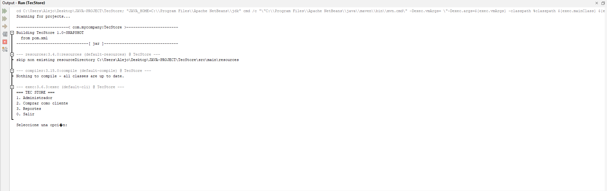
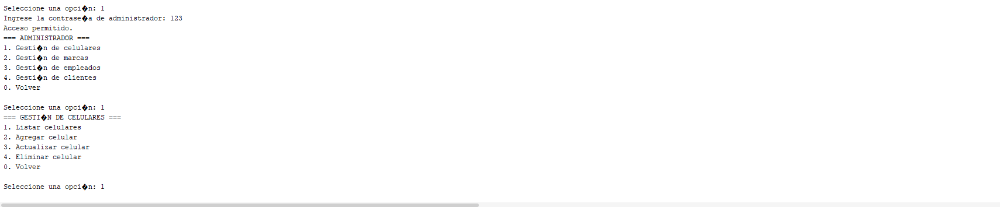
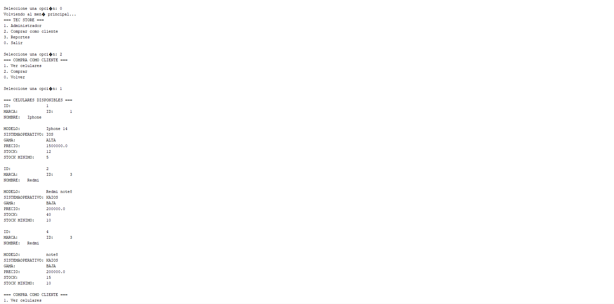
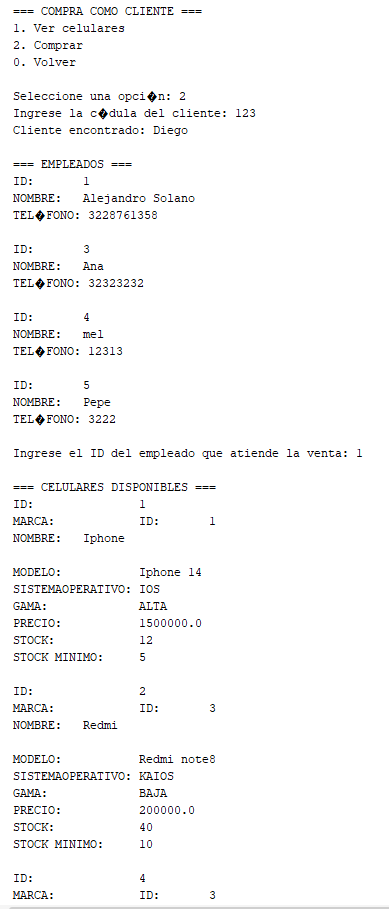
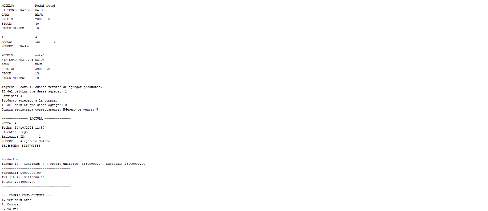
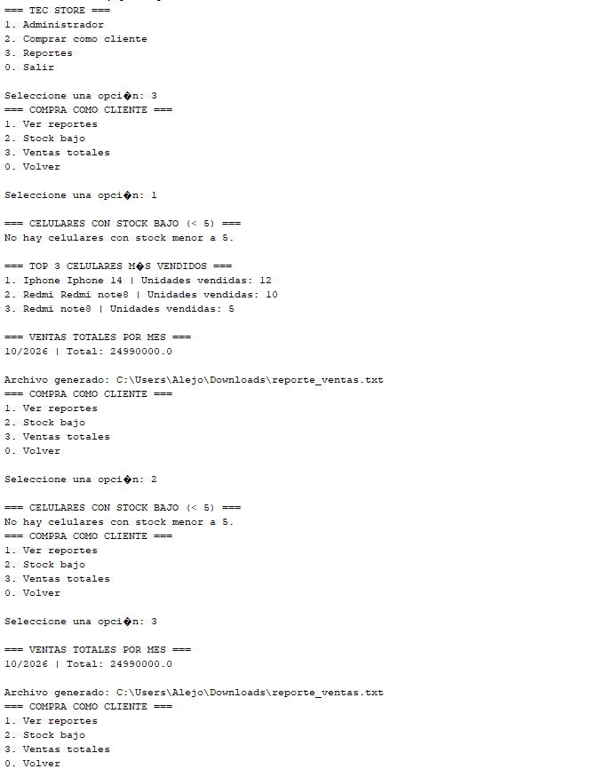

# TecnoStore - Sistema de gestión de celulares 📱

**Aplicación de consola — Java 17, Maven y MySQL**

TecnoStore es un sistema de consola para administrar el catálogo de celulares, los clientes, las ventas y los reportes de una tienda minorista. La aplicación persiste la información en MySQL mediante JDBC y permite consultar el inventario y el historial de ventas.

---

## 🔍 Problemática que resuelve

Llevar las ventas y el inventario en hojas de cálculo dificulta mantener los datos actualizados, controlar las existencias y consultar el historial de compras. TecnoStore reúne estas operaciones en una aplicación con menús de consola y una base de datos relacional.

## ✨ Funcionalidades

- Registrar, listar, actualizar y eliminar celulares.
- Administrar marcas, clientes y empleados.
- Validar los datos requeridos de celulares y clientes; la identificación del cliente es única en la base de datos.
- Registrar ventas de uno o varios celulares asociados a un cliente y a un empleado.
- Calcular el total con IVA del 19 % y descontar las unidades vendidas del inventario.
- Consultar celulares con menos de cinco unidades en stock.
- Consultar el top 3 de celulares más vendidos y los totales de ventas por mes.
- Generar un resumen de ventas en `reporte_ventas.txt`.
- Utilizar operaciones JDBC con transacciones y cierre de recursos mediante `try-with-resources`.

## 🧱 Estructura del proyecto

```text
JAVA-PROJECT/
├── README.md
├── database.sql                 # Crea la base de datos y las tablas
├── marca.sql                    # Procedimientos para marcas
├── celular.sql                  # Procedimientos para celulares
├── cliente.sql                  # Procedimientos para clientes
├── empleado.sql                 # Procedimientos para empleados
├── venta.sql                    # Procedimientos y trigger de ventas/inventario
├── reportes.sql                 # Consultas para reportes
└── TecStore/
    ├── pom.xml                  # Configuración Maven y conector MySQL
    └── src/main/java/
        ├── app/Main.java        # Punto de entrada
        ├── Dao/                 # JDBC y acceso a datos
        ├── controller/          # Flujo de menús y lógica de la aplicación
        ├── modelo/              # Celular, Cliente, Ventas y entidades relacionadas
        └── view/                # Menús, entrada de datos y factura
```

### Organización y conceptos aplicados

- **Modelo:** `Celular`, `Cliente`, `Persona`, `Marca`, `Ventas` y `DetalleVentas`. `Cliente` hereda de `Persona`; una venta contiene una colección de detalles.
- **Controladores:** gestionan los menús y coordinan las operaciones de celulares, clientes, compras y reportes.
- **DAO:** ejecutan procedimientos almacenados con JDBC. `VentaDAO` registra una venta dentro de una transacción.
- **Patrón Singleton:** `ConexionDao` controla el acceso a la configuración de conexión.
- **Colecciones y Stream API:** se utilizan para agrupar y calcular los reportes de inventario y ventas.

## 🛠 Tecnologías

| Tecnología | Uso |
|---|---|
| Java 17 | Lenguaje de programación |
| Maven | Compilación y gestión de dependencias |
| MySQL | Persistencia relacional |
| JDBC / MySQL Connector/J | Acceso a la base de datos |
| Stream API | Cálculo de reportes |

## ⚙️ Requisitos previos

- JDK 17.
- Maven 3.8 o posterior.
- MySQL 8 o compatible.
- Una instancia local de MySQL disponible.

## 🗄️ Preparar la base de datos

Los scripts SQL se encuentran en la raíz del repositorio. Ejecuta primero `database.sql` para crear la base `TecStoreAlejo` y las tablas. Después ejecuta los scripts de procedimientos almacenados en este orden:

1. `marca.sql`
2. `celular.sql`
3. `cliente.sql`
4. `empleado.sql`
5. `venta.sql`
6. `reportes.sql`

Puedes abrir y ejecutar los archivos desde MySQL Workbench. Desde el **Símbolo del sistema (CMD)** también puedes ejecutarlos con el cliente `mysql`, desde la raíz del repositorio:

```cmd
mysql -u root -p < database.sql
mysql -u root -p TecStoreAlejo < marca.sql
mysql -u root -p TecStoreAlejo < celular.sql
mysql -u root -p TecStoreAlejo < cliente.sql
mysql -u root -p TecStoreAlejo < empleado.sql
mysql -u root -p TecStoreAlejo < venta.sql
mysql -u root -p TecStoreAlejo < reportes.sql
```

Antes de iniciar la aplicación, revisa la URL, el usuario y la contraseña de MySQL configurados en `TecStore/src/main/java/Dao/ConexionDao.java` y ajústalos a tu entorno. No publiques credenciales reales en el repositorio.

## ▶️ Compilar y ejecutar

Clona el repositorio y entra a la carpeta Maven:

```powershell
git clone https://github.com/AlejoSDM/JAVA-PROJECT.git
cd JAVA-PROJECT\TecStore
```

Compila el proyecto:

```powershell
mvn clean package
```

Inicia la aplicación con Maven:

```powershell
mvn org.codehaus.mojo:exec-maven-plugin:3.5.0:java -Dexec.mainClass=app.Main
```

El menú principal permite entrar a la gestión de administrador, comprar como cliente o consultar reportes. La clave de administrador para esta versión de demostración está definida en `GestionGeneral.java`.

## 📄 Reporte de ventas

Al consultar los reportes generales o las ventas totales, se crea el archivo `reporte_ventas.txt` en la carpeta `Downloads` del usuario que ejecuta la aplicación.

## 📸 Capturas de ejecución

Agrega tus imágenes en `docs/capturas/` y reemplaza los nombres de ejemplo en los enlaces siguientes:

### Menú principal



### Gestión de celulares



### Registro de una venta y factura





### Reportes



## 👤 Autor

Proyecto desarrollado por **Alejandro Solano Durán**.

## 📌 Licencia y uso

Proyecto con fines educativos y demostrativos. No está preparado para uso en producción sin las modificaciones de seguridad, configuración y validación correspondientes.
